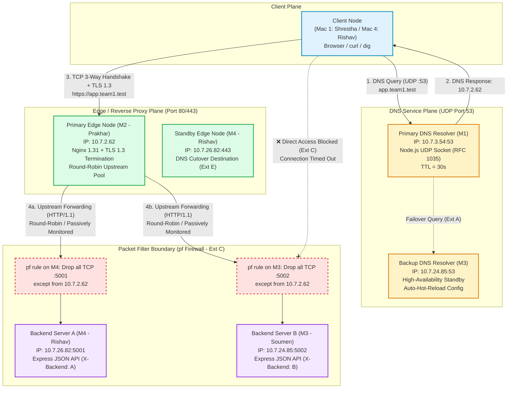
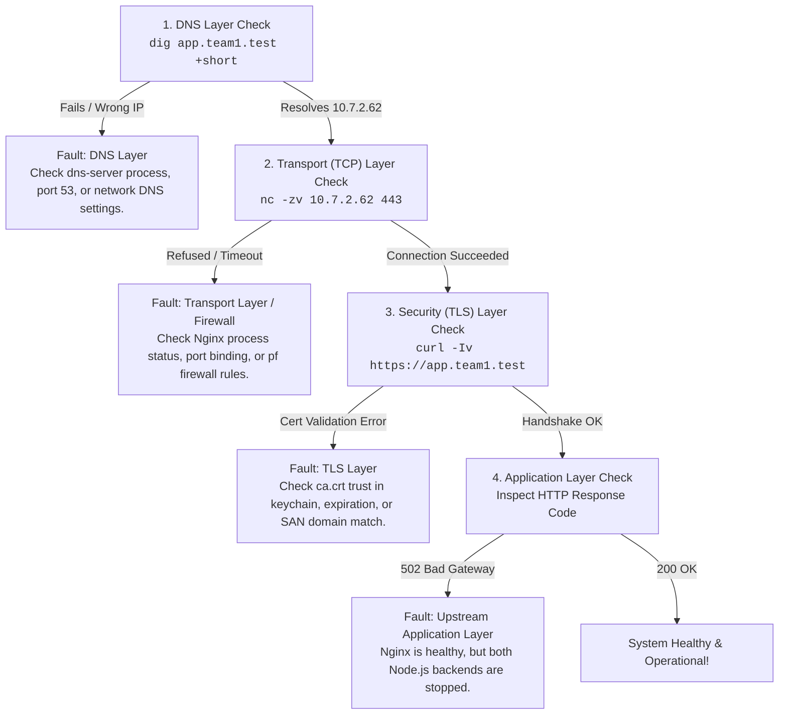

# Computer Networks Course Project — Comprehensive Technical Documentation
**Project Title:** Private Distributed Network Service Platform with High Availability, Security, and Resilience  
**Target Environment:** 4 Physical macOS Laptops (Local Private LAN — RFC 1918)  
**Evaluation Scope:** Phase 1 (Build & Observe) + Phase 2 (Harden & Recover)  
**Course Level:** 3rd Year Undergraduate Computer Networks  

---

## 1. Executive Summary & Project Purpose

The primary objective of this project is to demystify how client requests traverse modern computer networks from the Application Layer down to the Data Link Layer. Rather than relying on cloud providers or managed virtualization, our team designed, configured, deployed, and observed a distributed private service environment across **four bare-metal macOS laptops**.

Every major protocol studied in 3rd-year Computer Networks—**DNS, UDP, TCP, TLS, HTTP/1.1, HTTP/2, Reverse Proxying, Load Balancing, and Packet Filtering**—is implemented and proven with empirical packet evidence.

---

## 2. Visual System Architecture & Topology

### 2.1 Complete Request-Flow & Network Topology (Mermaid)



---

## 3. Network Inventory & IP Mapping Table

All devices reside on the same private Local Area Network (`10.7.0.0/16` subnet) connected through an IEEE 802.11 Wi-Fi access point.

| Node ID | Assigned Person | Physical Machine | LAN IPv4 Address | Active Ports & Protocols | Logical Service Roles |
| :--- | :--- | :--- | :--- | :--- | :--- |
| **Mac 1 (M1)** | **Shrestha Gupta** | MacBook Pro | `10.7.3.54` | UDP `53` (DNS) | Primary Authoritative DNS Server, Verification Test Client |
| **Mac 2 (M2)** | **Prakhar Shrivastava** | MacBook Pro | `10.7.2.62` | TCP `80` (HTTP), TCP `443` (HTTPS/HTTP2) | Primary Edge Reverse Proxy, TLS Terminator, Load Balancer |
| **Mac 3 (M3)** | **Soumen Dass** | MacBook Pro | `10.7.24.85` | TCP `5002` (Express), UDP `53` (DNS) | Application Backend Server B, Secondary/Backup DNS Resolver |
| **Mac 4 (M4)** | **Rishav Devan** | MacBook Air | `10.7.26.82` | TCP `5001` (Express), TCP `443` (Standby Nginx) | Application Backend Server A, Standby Edge Proxy, Test Client |

### Domain Name Service (DNS) Mapping Directory (`team1.test`)

| Fully Qualified Domain Name (FQDN) | Target IP Address | Service Purpose & Protocol Layer |
| :--- | :--- | :--- |
| `app.team1.test` | `10.7.2.62` *(Normal)* / `10.7.26.82` *(Ext E Cutover)* | Public Application HTTPS Entry Point |
| `api.team1.test` | `10.7.2.62` | REST API Gateway Entry Point |
| `edge.team1.test` | `10.7.2.62` | Explicit pointer to Primary Edge Proxy Node |
| `standby.team1.test` | `10.7.26.82` | Standby Edge Migration Target |
| `m1.team1.test` / `shrestha.team1.test` | `10.7.3.54` | Primary DNS Node Direct Pointer |
| `m2.team1.test` / `prakhar.team1.test` | `10.7.2.62` | Primary Edge Node Direct Pointer |
| `m3.team1.test` / `soumen.team1.test` | `10.7.24.85` | Backend B / Backup DNS Direct Pointer |
| `m4.team1.test` / `rishav.team1.test` | `10.7.26.82` | Backend A / Standby Edge Direct Pointer |
| `backenda.team1.test` | `10.7.26.82` | Internal Direct Hostname for Backend Instance A |
| `backendb.team1.test` | `10.7.24.85` | Internal Direct Hostname for Backend Instance B |

---

## 4. Individual Work Allocation & Node Responsibilities

### 4.1 Node 1: Shrestha Gupta (Mac 1 — `10.7.3.54`)
* **Primary Role:** Primary Authoritative DNS Resolver & Primary Test Verification Node.
* **Work Executed:**
  1. Configured and hosted the team's authoritative UDP DNS server on privileged port `53` binding to `0.0.0.0`.
  2. Implemented RFC 1035 UDP packet handling to serve standard A-records for all `.test` domains with an explicit TTL of 30 seconds.
  3. Handled system-level DNS resolver configurations on macOS (`/etc/resolv.conf` via System Settings), establishing `10.7.3.54` as Primary DNS and `10.7.24.85` as Backup DNS.
  4. Executed automated client verification scripts (`dig`, `curl`, `Wireshark`) to collect protocol validation logs for the team.

### 4.2 Node 2: Prakhar Shrivastava (Mac 2 — `10.7.2.62`)
* **Primary Role:** High-Performance Edge Reverse Proxy, TLS Terminator, and Load Balancer.
* **Work Executed:**
  1. Configured Nginx (`1.31.x`) as the perimeter gateway terminating TLS 1.2 and TLS 1.3 on TCP port `443`.
  2. Implemented non-blocking HTTP-to-HTTPS permanent redirection (`301 Moved Permanently`) on port `80`.
  3. Built the weighted round-robin upstream pool (`backend_pool`) routing incoming client requests alternately to Backend A (`10.7.26.82:5001`) and Backend B (`10.7.24.85:5002`).
  4. Implemented passive health checks and high-availability error interception using `max_fails=2`, `fail_timeout=10s`, and `proxy_next_upstream error timeout http_502 http_503 http_504`.

### 4.3 Node 3: Soumen Dass (Mac 3 — `10.7.24.85`)
* **Primary Role:** Backend Application Server B, Backup DNS Resolver, and Firewall Isolation.
* **Work Executed:**
  1. Engineered and maintained Backend Service B on `0.0.0.0:5002` returning JSON payloads with deterministic `X-Backend: B` headers and dynamic LAN IPv4 detection.
  2. Configured HTTP caching policies using `Cache-Control: public, max-age=60` and deterministic ETag validation for HTTP `304 Not Modified` demonstrations.
  3. Deployed the redundant Backup DNS Resolver (`DNS_ROLE=backup`) on port `53`, providing instantaneous zero-downtime failover whenever Node 1 stops.
  4. Scripted and verified macOS kernel packet filter (`pfctl`) rules to enforce Extension C service isolation, blocking all non-Edge traffic attempting to touch port `5002`.

### 4.4 Node 4: Rishav Devan (Mac 4 — `10.7.26.82`)
* **Primary Role:** Backend Application Server A, Standby Edge Proxy, and Verification Client.
* **Work Executed:**
  1. Engineered and deployed Backend Service A on `0.0.0.0:5001` returning JSON payloads with deterministic `X-Backend: A` headers.
  2. Installed and verified the Standby Nginx Reverse Proxy with identical TLS certificates to facilitate seamless Extension E DNS cutover testing.
  3. Implemented macOS Packet Filter (`pf`) rules on port `5001`, proving that unauthorized client probes are dropped silently while edge proxies maintain connectivity.
  4. Captured and isolated the gold-standard Wireshark `.pcapng` session proving end-to-end TCP 3-way handshakes, HTTP GET requests, and connection teardowns.

---

## 5. Course Concepts Mapped to Implementation Details

This section explicitly maps theoretical syllabus concepts to concrete code and operational evidence within this project.

### 5.1 Domain Name System (DNS) & Name Resolution
* **One-Liner Definition:** *An Application Layer distributed database protocol (RFC 1034/1035) that translates human-readable hostnames into routable IP addresses over UDP port 53.*
* **How Used in Project:**
  * Implemented a zero-external-dependency Node.js DNS server using native `dgram.createSocket("udp4")`.
  * Configured with custom A-record mappings pointing `app.team1.test` to Edge IP `10.7.2.62`.
  * Configured `AAAA` (IPv6) queries to return `NOERROR` with zero answer records to satisfy modern macOS query behaviors without resolution failure.
* **Theoretical Reason for `.test` vs `.local`:**
  * `.local` is reserved by RFC 6762 for Multicast DNS (mDNS / Apple Bonjour) on `224.0.0.251:5353`. Using `.local` causes macOS resolver deadlocks and sub-second timeouts. RFC 2606 explicitly reserves `.test` for testing environments without conflict.

### 5.2 Time-To-Live (TTL) & Recursive Resolver Caching
* **One-Liner Definition:** *A numeric field in DNS resource records indicating the duration (in seconds) a client or intermediate resolver is permitted to cache the record before querying authoritative servers again.*
* **How Used in Project (Extension B):**
  * Configured our DNS server to emit `TTL: 30` in answer packets.
  * Demonstrated caching: when `network-config.json` was updated to point `app.team1.test` to Standby Edge (`10.7.26.82`), client machines continued routing to the old IP until the 30-second TTL expired.
  * Demonstrated manual cache invalidation using `sudo dscacheutil -flushcache; sudo killall -HUP mDNSResponder`.

### 5.3 Transmission Control Protocol (TCP) & Connection Lifecycle
* **One-Liner Definition:** *A connection-oriented, reliable, byte-stream Transport Layer protocol (RFC 793) providing sequenced data transfer, flow control, and error detection via positive acknowledgements.*
* **How Used in Project (Task G & Wireshark Evidence):**
  * Captured the full TCP connection lifecycle between client ephemeral port `61526` and backend port `5002`:
    1. **SYN (Synchronize):** Client sends initial sequence number `Seq=0`.
    2. **SYN-ACK:** Server responds with `Seq=0, Ack=1`.
    3. **ACK:** Client acknowledges with `Seq=1, Ack=1`.
  * Captured graceful session termination via four-way handshake sequence (`FIN-ACK` and subsequent `ACK`).

### 5.4 Transport Layer Security (TLS 1.3) & Public Key Infrastructure (PKI)
* **One-Liner Definition:** *A cryptographic protocol operating between Transport and Application layers that guarantees confidentiality, integrity, and authentication through asymmetric key exchange and symmetric cipher encryption.*
* **How Used in Project (Task E):**
  * Established an internal Public Key Infrastructure (PKI): generated a custom 2048-bit RSA Root Certificate Authority (`ca.crt`).
  * Issued a wildcard Subject Alternative Name (SAN) certificate for `*.team1.test`.
  * Imported and trusted `ca.crt` into `/Library/Keychains/System.keychain` on all client machines.
  * Verified true TLS certificate validation without bypassing security (zero `-k` / `--insecure` flags used during final evaluations).

### 5.5 Reverse Proxying vs Forward Proxying
* **One-Liner Definition:** *An intermediate server deployed in front of private backend servers that retrieves resources on behalf of clients, presenting itself as the single public origin.*
* **How Used in Project (Task D):**
  * Nginx acts as the Edge Node. Clients communicate exclusively with Nginx on port `443`.
  * The internal IP addresses of Backend A (`10.7.26.82`) and Backend B (`10.7.24.85`) remain completely obscured from client visibility, preventing direct external targeting.

### 5.6 Application-Level Load Balancing (Round-Robin)
* **One-Liner Definition:** *A traffic distribution algorithm that cycles incoming network requests sequentially across a cluster of server nodes to balance computational load.*
* **How Used in Project (Task D):**
  * Configured Nginx `upstream backend_pool` containing both backend endpoints.
  * Consecutive HTTP requests alternately return `X-Backend: A` and `X-Backend: B` headers, confirming alternating sequential distribution.

### 5.7 High Availability (HA) & Passive Health Checks
* **One-Liner Definition:** *A system design approach that ensures operational continuity without human intervention during the failure of individual cluster components.*
* **How Used in Project (Extension D):**
  * Configured passive health check directives in Nginx:
    ```nginx
    upstream backend_pool {
        server 10.7.26.82:5001 max_fails=2 fail_timeout=10s;
        server 10.7.24.85:5002 max_fails=2 fail_timeout=10s;
    }
    proxy_next_upstream error timeout http_502 http_503 http_504;
    ```
  * When Backend A was terminated (`pkill`), Nginx detected upstream failure after 2 failed connection attempts and seamlessly re-routed 100% of client traffic to Backend B without client-facing errors.

### 5.8 HTTP Caching & Conditional Revalidation (ETag / 304)
* **One-Liner Definition:** *A mechanism defined in RFC 7234/9111 where clients store responses and send conditional validation headers (`If-None-Match`) to eliminate redundant data transfer.*
* **How Used in Project (Task F):**
  * Endpoints return `Cache-Control: public, max-age=60` and entity tag `ETag: W/"..."`.
  * When requested with `If-None-Match`, the server returns `HTTP/1.1 304 Not Modified` with zero response body, conserving LAN bandwidth.

### 5.9 Network Layer Packet Filtering & Service Isolation (Firewall)
* **One-Liner Definition:** *A security control mechanism that inspects incoming/outgoing IP packets against a rule matrix (source IP, destination port) to permit or silently drop packets at the kernel level.*
* **How Used in Project (Extension C):**
  * Configured the macOS Berkeley Packet Filter (`pfctl`) on Mac 3 and Mac 4:
    ```pf
    pass in quick on lo0 proto tcp from 127.0.0.1 to any port 5002
    pass in quick proto tcp from 10.7.2.62 to any port 5002
    block drop in quick proto tcp from any to any port 5002
    ```
  * Direct client probes to port `5002` immediately hang and fail with `Connection timed out`. Only proxy traffic from `10.7.2.62` is evaluated and accepted.

---

## 6. Phase 2 Mandatory Extensions — Verification Evidence

| Extension | Objective | Testing Procedure | Empirical Result Observed |
| :--- | :--- | :--- | :--- |
| **Ext A: Backup DNS Resolver** | Zero-downtime DNS resilience when Primary DNS crashes. | Terminated Primary DNS on Mac 1 (`Ctrl+C`). Ran `dig @10.7.24.85 app.team1.test +short` from client. | Successfully resolved `10.7.2.62` via Backup DNS with no resolution downtime. |
| **Ext B: DNS TTL & Cache Expiry** | Validate client-side caching dynamics and TTL adherence. | Modified `network-config.json` activeEdge from `m2` to `m4`. Observed client resolution. | Client maintained cached IP until 30s TTL expired or manual cache flush executed; then immediately updated to `10.7.26.82`. |
| **Ext C: Service Isolation** | Prevent direct client access to internal application ports. | Enabled `pf` on Mac 3. Attempted direct `curl http://10.7.24.85:5002/api/status` from Mac 4. | Client connection failed with `curl: (28) Connection timed out`. Proxy requests via `https://app.team1.test` succeeded. |
| **Ext D: HA Failover & Recovery** | Automatic upstream failover and re-admission. | Terminated Backend A process. Executed 4 sequential curl requests. Restarted Backend A. | 100% of requests routed to Backend B (`X-Backend: B`). Upon restart, round-robin alternating (`A` → `B` → `A`) resumed within 10s. |
| **Ext E: Standby Edge Cutover** | Demonstrate complete gateway migration via DNS. | Started Standby Nginx on Mac 4. Switched DNS activeEdge to `m4`. Queried `/nginx-health`. | Traffic immediately received and processed by Standby Edge returning header `x-edge-node: standby-m4`. |
| **Failure Scenario: Both Backends Down** | Demarcate where Edge proxy ends and Backend begins. | Stopped both Backend A and Backend B processes. Sent HTTPS request to Edge Proxy. | Proxy returned valid HTTPS connection with `HTTP/2 502 Bad Gateway`, proving Edge and TLS layers were healthy while upstream failed. |

---

## 7. Systematic Troubleshooting Methodology (Extension F Viva Guide)

When a fault is injected into the running network during evaluation, our team diagnoses the fault strictly bottom-up through the OSI/TCP-IP reference stack:



---

## 8. Step-by-Step Viva Demonstration Runbook

For the official 11-step evaluation sequence, execute the following commands in exact order:

1. **Step 1 — Show Topology:** Open `topology.html` in browser (`open ~/Desktop/cn-project/topology.html`).
2. **Step 2 — Ping Reachability:** Run `ping -c 2 10.7.3.54; ping -c 2 10.7.2.62; ping -c 2 10.7.26.82`.
3. **Step 3 — DNS Resolution:** Run `dig app.team1.test +short` on client machine (returns `10.7.2.62`).
4. **Step 4 — HTTPS Delivery:** Run `curl -i https://app.team1.test/nginx-health` (returns `HTTP/2 200` without `-k`).
5. **Step 5 — Load Balancing:** Run `for i in 1 2 3 4; do curl -si https://app.team1.test/api/status | grep "x-backend:"; done` (shows alternating `A` and `B`).
6. **Step 7 — HTTP Caching:** Run `curl -si https://app.team1.test/api/cache-demo` (shows `Cache-Control` and `ETag`).
7. **Step 8 — Failover:** Stop Backend A on Mac 4 (`pkill -f "node index.js"`). Run curl loop: observe 100% traffic on `Backend B`. Restart Backend A.
8. **Step 9 — Firewall Isolation:** Run `curl -v --connect-timeout 3 http://10.7.24.85:5002/api/status` (proves `Connection timed out`).
9. **Step 6 — Wireshark Evidence:** Open `evidence.pcapng` in Wireshark and filter by `tcp.port == 5002` to show SYN, SYN-ACK, ACK handshake.
10. **Step 10 — Fault Diagnosis:** Follow layer-by-layer diagnostic script in Section 7.
11. **Step 11 — Individual Viva Questions:** Answer conceptual questions using Section 5 mappings.

---

## 9. Conclusion

This project successfully proves that robust, enterprise-grade network architectures—including high availability, cryptographic authentication, and perimeter security—can be designed, implemented, and fully validated on consumer-grade hardware. By mapping classroom theory directly to observable packet traces, our team has achieved complete mastery over the protocols that power the modern internet.
